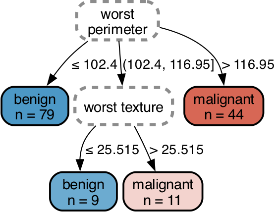

# SPLINTER

Official code for the NeurIPS 2026 paper: **Interpretable Multiway-Split Trees**, by Bo Chi\*, Yulin Zhang\*, Chudi Zhong, and Cynthia Rudin.

SPLINTER is a family of accurate, fast, and interpretable multiway-split decision tree algorithms that combine DP with BnB search. The algorithms learn trees with multiway splits, where a node can have more than 2 branches. For example, one node can send low, medium, and high values of a feature to 3 different branches. Nonlinear splits can also group non-adjacent ranges, such as low and high values, into the same branch.

We first fit LightGBM on the training data and collect the thresholds used in its trees. These thresholds are possible split points for each feature: a split at age 50, for example, makes 50 a candidate threshold for age. SPLINTER uses them to propose multiway splits and looks ahead at the subtrees each split could produce before choosing among them. You can reuse the same LightGBM thresholds when fitting trees with different settings.

We also implement RESPLINTER, which builds a Rashomon set of near-optimal trees. This lets you compare different rules for the same data, sample alternative trees, and see where their predictions disagree.

<p align="center">
  
</p>

\* Equal contribution.

## Installation

You need Python 3.10–3.12 and [Rust with Cargo](https://rustup.rs/). The commands below use [uv](https://docs.astral.sh/uv/getting-started/installation/) to create a Python environment and install the package. On macOS, first install OpenMP with `brew install libomp`.

```bash
git clone https://github.com/frankyzha/SPLINTER.git
cd SPLINTER
uv sync --locked
uv run python examples/classification.py
```

The first installation compiles the solver and may take a few minutes. The last command fits 2 trees and prints their accuracy, size, and rules.

If you prefer pip, run these commands from the repository root after cloning it.

```bash
python3 -m venv .venv
source .venv/bin/activate
python -m pip install .
python examples/classification.py
```

## Fit a tree

This example uses data bundled with scikit-learn. Run it in a Python session started with `uv run python`, or in the environment where you installed the package.

```python
from sklearn.datasets import load_breast_cancer
from sklearn.model_selection import train_test_split
from splinter import SPLINTER, explain

data = load_breast_cancer()
X_train, X_test, y_train, y_test = train_test_split(
    data.data, data.target_names[data.target],
    test_size=0.25, stratify=data.target, random_state=42,
)

model = SPLINTER(max_depth=3, lgbm_n_estimators=16)
model.fit(X_train, y_train, feature_names=data.feature_names)
print(model)
print("Test accuracy:", model.score(X_test, y_test))
print(model.predict(X_test[:3]))
print(explain(model, X_test[:1]))
```

`model.predict_proba(X_test)` gives the class shares in each row's leaf. These examples set `lgbm_n_estimators=16` to keep LightGBM fitting quick; the default uses more trees to propose thresholds.

To use your own data, pass a numeric matrix `X` and a one-dimensional array of class labels `y`. Missing values and infinities must be handled before fitting. Encode categorical features as integers, and use the same columns in the same order for prediction.

## Reuse LightGBM thresholds

When trying several tree settings on the same training data, you can fit LightGBM once and reuse its thresholds. Call `fit_thresholds` before the loop, then pass the cache to each model through `precomputed_thresholds`.

```python
from splinter.thresholds import fit_thresholds

cache = fit_thresholds(X_train, y_train, n_estimators=16)
for depth in (2, 3):
    cached_model = SPLINTER(max_depth=depth, precomputed_thresholds=cache)
    cached_model.fit(X_train, y_train, feature_names=data.feature_names)
    print(f"Depth {depth}: {cached_model.score(X_test, y_test):.3f} test accuracy")
```

ShapeSPLINTER and LicketySPLINTER accept the same cache. For RESPLINTER, pass `fixed_thresholds=cache.thresholds` instead. To keep the cache between runs, use the [threshold reuse demo](examples/precompute_thresholds.py) with a cache file:

```bash
uv run python examples/precompute_thresholds.py --cache thresholds.npz
```

The first run fits LightGBM and saves the cache. Later runs load that file and generate trees without fitting LightGBM again. The demo reports LightGBM fitting time separately from tree generation time.

Compute the cache from the training split only, and reuse it with the same training rows, labels, and row and column order. The cache includes LightGBM's scores for those rows, which nonlinear splits use. For cross-validation, compute a separate cache for each training fold.

## Generate a Rashomon set

For binary tasks, `RESPLINTER` collects trees whose training error rate plus `reg` per leaf is close to the best score found. With `theta=0.05`, a best score of 0.10 gives a cutoff of 0.105. Reusing the split above, this example prints a best tree, samples 3 alternatives, and predicts by voting across the set.

```python
from splinter import RESPLINTER, export_text

rset = RESPLINTER(max_depth=2, max_k=3, theta=0.05, lgbm_n_estimators=16)
rset.fit(X_train, y_train, feature_names=data.feature_names)

print(rset.summary())
print("Trees in the reported set:", rset.tree_count_at_target_)
print(export_text(rset.get_tree(0), classes=rset.classes_))
alternatives = rset.sample_trees(3, seed=0, at_target=True)
print(rset.predict_proba(X_test[:3]))
```

This run found 15 trees, and `[0.2, 0.8]` for the third test row means 3 voted benign and twelve malignant, following the order in `rset.classes_`.

The trees from `get_tree` and `sample_trees` can be printed with `export_text` or drawn with `plot_tree`. Include `classes=rset.classes_` to show the original labels.

The guarantee covers trees made from the splits kept by the search. Check `rset.guarantee()["complete"]` to see whether every such tree within the cutoff was found. The summary reports this separately from whether the best tree was proven optimal. A time limit or `cart_closure=True` can leave the set incomplete.

RESPLINTER does not enforce a minimum leaf size. To require one, filter the fitted trees with `rashomon_table` and `select` from `splinter.explore`, as in the [set example](examples/rashomon_demo.py).

### Save and load

```python
rset.save("rashomon_set.npz")
loaded = RESPLINTER.load("rashomon_set.npz")
print(loaded.predict(X_test[:3]))
```

`save` stores the set together with its training rows, labels, and thresholds. `load` restores it without refitting LightGBM.

## Choose a method

The example in [Fit a tree](#fit-a-tree) uses `SPLINTER`, whose branches cover contiguous ranges of a feature. You can replace it with `ShapeSPLINTER` when non-adjacent ranges should lead to the same branch. `LicketySPLINTER` evaluates candidate root splits using their completed subtrees, keeps one split, and repeats the search on each child; set `shape_mode=True` to allow nonlinear splits as well.

All 3 handle 2–16 classes and can be imported from `splinter`, so you can use them with the fitting and prediction calls shown above. `RESPLINTER` handles binary tasks when you want a set of good trees instead of one.

## Main parameters

`max_depth` and `max_k` control the shape of a tree: the first limits the number of decisions along a path, and the second limits the number of branches at a node. Increasing `reg` puts a larger penalty on each leaf and favors smaller trees. The single-tree methods also accept `min_samples_leaf` when you want to avoid leaves supported by very few training rows.

For SPLINTER and ShapeSPLINTER, `lookahead_depth` sets how many top levels are searched before the lower branches are completed greedily. In RESPLINTER, it sets the depth of the first enumeration, after which the remaining levels are filled recursively. Leaving it as `None` uses `max_depth // 2`.

Use `help(SPLINTER)` or `help(RESPLINTER)` for the remaining parameters and their defaults, including controls over the candidate thresholds, search width, and running time.

## Draw a tree

To draw a tree, install the visualization dependencies.

```bash
uv sync --locked --extra visualization
```

Install Graphviz with `brew install graphviz` on macOS or `sudo apt-get install graphviz` on Debian/Ubuntu. The following code draws the single tree and a tree from the Rashomon set.

```python
from splinter.viz import plot_tree

plot_tree(model, X_test, y_test).render("tree", format="png", cleanup=True)
plot_tree(rset.get_tree(0), X_test, y_test, classes=rset.classes_).render(
    "rashomon_tree", format="png", cleanup=True,
)
```

This writes `tree.png` and `rashomon_tree.png`. In Jupyter, `plot_tree(...)` displays inline. Printing a tree as text needs no visualization dependencies.

## Examples

All demos are in `examples/`, and you can run the commands below from the repository root. The Python implementation is in `python/splinter/`, and the native solver is in `src/`.

| Command | What it shows |
|---|---|
| `uv run python examples/classification.py` | SPLINTER and ShapeSPLINTER fit trees and report their accuracy and size. |
| `uv run python examples/precompute_thresholds.py` | One LightGBM fit supplies thresholds for several tree fits. |
| `uv run python examples/recursive_lookahead.py` | LicketySPLINTER fits trees using contiguous and nonlinear splits. |
| `uv run python examples/compare_cart.py` | SPLINTER and CART are compared using five-fold cross-validation. |
| `uv run python examples/rashomon.py` | RESPLINTER generates a set and reports its best tree and search guarantees. |
| `uv run python examples/explain.py` | The demo shows which rules lead to a prediction. |
| `uv run --extra visualization python examples/visualize.py` | The plots show contiguous, nonlinear, categorical, and multiclass trees. |
| `uv run --extra visualization python examples/rashomon_demo.py` | The demo explores alternative trees, prediction differences, variable importance, and plots. |

There are also notebooks for [tree visualization](examples/visualize.ipynb) and [Rashomon sets](examples/rashomon_demo.ipynb). Development instructions are in [CONTRIBUTING.md](CONTRIBUTING.md).

## Citation

```bibtex
@inproceedings{chi2026splinter,
  title     = {Interpretable Multiway-Split Trees},
  author    = {Chi, Bo and Zhang, Yulin and Zhong, Chudi and Rudin, Cynthia},
  booktitle = {Advances in Neural Information Processing Systems},
  year      = {2026}
}
```

Software citation metadata is in [CITATION.cff](CITATION.cff).

## License

The software is available under the MIT license; see [LICENSE](LICENSE) for the terms. The examples use scikit-learn's bundled datasets or generate synthetic data.
